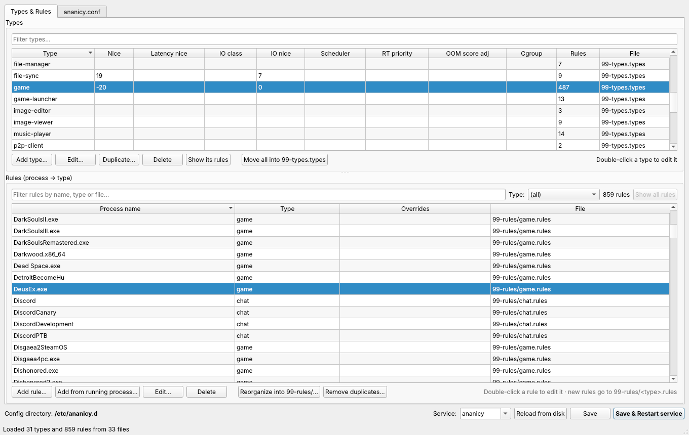
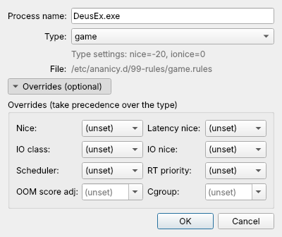

<p align="center">
  
</p>

<h1 align="center">Ananicy Configurator</h1>

<p align="center">
  A Qt / C++ GUI editor for <a href="https://github.com/Nefelim4ag/Ananicy">Ananicy</a> and
  <a href="https://gitlab.com/ananicy-cpp/ananicy-cpp">ananicy-cpp</a> configuration.
</p>



<p align="center">
  
  <br><em>Editing a rule: pick a type, optionally unfold the per-rule overrides.</em>
</p>

## Features

- **Types & Rules tab**
  - Table of all types (from every `*.types` file) showing their settings and how many rules use them.
    **Show its rules** filters the rules list by the selected type; **Show all rules** clears the filter.
  - Table of all rules (every `*.rules` file under the config dir, including `00-default/**` and
    `99-rules/`), with search and a type filter.
  - Double-click an entry (or select it and press **Edit…** / Enter) to edit it in a pop-up dialog;
    **Add…** opens the same dialog for a new entry. Changes are only applied when you press OK.
  - In the type dialog, every setting except the name is a drop-down: `nice`, `latency_nice`,
    `ioclass`, `ionice`, `sched`, `rtprio`, `oom_score_adj`, `cgroup` (cgroups come from your
    `*.cgroups` files).
  - In the rule dialog, you assign the process a type from the types that exist. Optional per-rule
    overrides are folded away under **Overrides**; the button shows how many are set.
  - **Add from running process…** lists the running processes (grouped by `/proc/PID/comm`, with
    executable, command line and any existing rule) and creates a rule from your pick.
- **ananicy.conf tab**: all known keys as drop-downs (`check_freq`, `*_load`, `apply_*`,
  `loglevel`, …). Keys the program doesn't know about are kept and can be edited too.
- **Save** / **Save & Restart service**: writes the changed files, then runs
  `systemctl restart <service>`. The service name is auto-detected (`ananicy` or `ananicy-cpp`)
  and can be changed in the bottom bar.

## Where changes are written

| What | File |
|---|---|
| Changed existing rule | the same file it was loaded from (only that line changes), even if its type changes |
| New rule with a type | `/etc/ananicy.d/99-rules/<type>.rules`, e.g. `99-rules/game.rules` |
| New rule without a type | `/etc/ananicy.d/99-rules/custom.rules` |
| Changed existing type | the same file it was loaded from |
| New type | `/etc/ananicy.d/99-types.types` |
| ananicy.conf settings | `/etc/ananicy.d/ananicy.conf` |

A new rule follows its type until it is saved: if you change its type before saving, it moves to
the matching file. Characters that aren't safe in a file name become `_` (type `a,b` →
`a_b.rules`). A type named `custom` uses `type-custom.rules`, because `custom.rules` is reserved
for rules without a type.

**Move all into 99-types.types** (under the types list) moves every type into that one file.
**Reorganize into 99-rules/…** moves every rule into the structure above. If some process names
have more than one rule, it first offers to remove the duplicates. Otherwise copies with
different types would end up in different files, which can change which copy Ananicy uses.
**Remove duplicates…**
keeps one rule per process name and deletes the other copies. For each name it keeps the copy in
the file that sorts last, so a rule in `99-rules` wins over one in `00-default`. Rules that are
duplicates are shown in red until you remove them. Neither button writes anything until you
press Save.

Comments, blank lines, formatting of untouched lines and unknown keys are preserved byte-for-byte.
Only files that actually changed are written; no backup copies are made. A file that ends up with
no rules or types (for example after reorganizing) is deleted, along with any folders that are
left empty. Comments in a deleted file are not kept.

### Safety checks before saving

- The program refuses to start with `/` or a top-level folder (such as `/etc`, `/usr` or
  `/home`) as its config directory, so it never even reads files all over the system.
- Only `*.rules` / `*.types` files the program loaded itself, plus `ananicy.conf`, are ever
  written or deleted, and only inside the config directory. Folders are only removed when they
  are empty, and never the config directory itself.
- Symlinked folders are not followed (ananicy-cpp doesn't follow them either), and symlinked
  files are never written or deleted.
- If any file changed on disk after it was loaded (e.g. by a package update), nothing is saved:
  use "Reload from disk" and redo your changes.
- A file is only deleted if nothing but comments and blank lines is left in it. A file that still
  has lines the program couldn't read is kept.
- Before deleting files, the program lists them and asks for confirmation.

## Root permissions

Run the program as your normal user. On save, it stages the files in a temp dir and runs **one**
`pkexec` command (one password prompt) that installs them and restarts the service. If you start it
as root, it writes directly.

## Build

Dependencies: CMake ≥ 3.16, a C++17 compiler, Qt 6 (or Qt 5.15) Widgets.

```bash
# Arch:          sudo pacman -S cmake qt6-base
# Debian/Ubuntu: sudo apt install cmake g++ qt6-base-dev
# Fedora:        sudo dnf install cmake gcc-c++ qt6-qtbase-devel

cmake -S . -B build -DCMAKE_BUILD_TYPE=Release
cmake --build build -j
./build/ananicy-gui

# optional: install to /usr/local (binary, .desktop entry and icon)
sudo cmake --install build
```

To try it on a copy of your config without touching `/etc`:

```bash
cp -r /etc/ananicy.d /tmp/ananicy-test
./build/ananicy-gui --root /tmp/ananicy-test
```

## Arch Linux package

The `PKGBUILD` in the project root builds the package from this checkout. Nothing is downloaded,
and your local changes are included:

```bash
cd AnanicyConfigurator
makepkg -si
```

The build files go to `build/`, and the finished package (`ananicy-configurator-*.pkg.tar.zst`)
is written to the project root. The package installs `/usr/bin/ananicy-gui`, a desktop entry
("Ananicy Configurator") and the app icon.

To rebuild after changing or pulling the code, run `makepkg -sif`. To uninstall, run
`sudo pacman -R ananicy-configurator`.

## Debian / Ubuntu and Fedora packages

CPack builds a `.deb` and/or `.rpm`. Build each package **on the distribution it is for**: the Qt
dependencies are read from the system it is built on, and Debian, Ubuntu and Fedora name their
Qt packages differently (for example `libqt6core6` on Debian 12 vs `libqt6core6t64` on
Ubuntu 24.04).

```bash
# Debian / Ubuntu:  sudo apt install cmake g++ qt6-base-dev dpkg-dev
# Fedora:           sudo dnf install cmake gcc-c++ qt6-qtbase-devel rpm-build
cmake -S . -B build -DCMAKE_BUILD_TYPE=Release
cmake --build build -j
cd build && cpack
# -> ananicy-configurator_1.0.0-1_amd64.deb   (if dpkg-deb is installed)
# -> ananicy-configurator-1.0.0-1.x86_64.rpm  (if rpmbuild is installed)

sudo apt install ./ananicy-configurator_1.0.0-1_amd64.deb   # Debian / Ubuntu
sudo dnf install ./ananicy-configurator-1.0.0-1.x86_64.rpm  # Fedora
```

CPack has no generator for Arch Linux packages; use the `PKGBUILD` above for Arch.

## Notes

- Ananicy matches rules against the kernel process name (`/proc/PID/comm`), which the kernel cuts
  off at 15 characters. The editor warns you when a name is longer than that.
- If the same process name has rules in more than one file, Ananicy uses the last one it loads.
  The editor's "already exists" warnings point to the existing file.
- Rules or types that point to a missing type, or that have the same name more than once, are
  shown in red.
